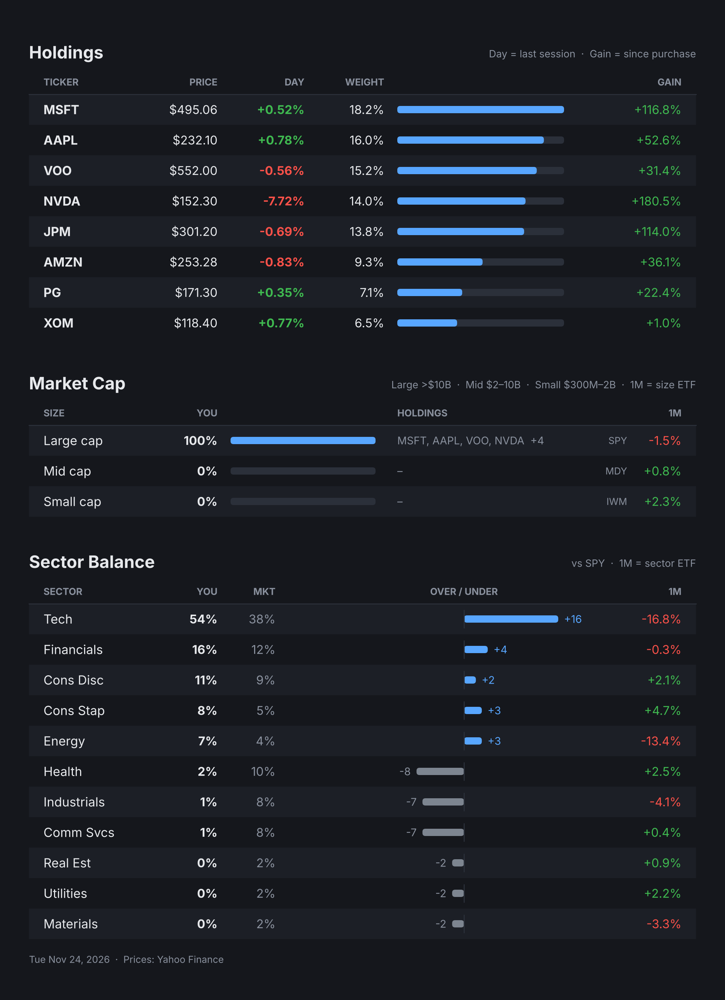

# Market Brief

[](https://github.com/Pulse-Robotics/market_brief/actions/workflows/tests.yml)

A daily portfolio brief posted to Discord before the US market opens.

Each weekday morning it:

1. Reads your holdings from a Yahoo Finance portfolio export
2. Pulls fresh prices, previous closes and company-specific headlines from Yahoo
3. Has Gemini write one short note per holding explaining the move, using only the headlines
4. Breaks down your **sector** mix vs the S&P 500 and your **large / mid / small cap** mix
5. Suggests stocks to research in each cap tier that would fill your gaps
6. Posts one Discord message with the commentary and an image of the tables



*Sample made from the example portfolio with placeholder prices.*

The message text looks like this:

```
## 📈 Morning Brief · Tue Nov 24
> $21,800.66 · 🔴 -$247.86 (-1.12%) last session · 🟢 +$8,523.96 (+64.20%) total

Mega-cap tech led while banks and the broad index slipped.

- 🔺 MSFT +0.52% · No specific news.
- 🔻 NVDA -7.72% · Questions over management persist after a leadership change.
- 🔻 JPM -0.69% · Cut net interest income guidance at an investor conference.
...

### ⚖️ Balance
- Tech at 54% vs 38% market while the sector ETF fell 17% this month.

### 💡 Ideas to research
Large cap
- UNH · Adds healthcare; largest US health insurer.
Mid cap
- ...
Small cap
- ...
```

> This is a personal tool. Summaries and ideas are AI-generated from limited data (prices,
> headlines and sector weights, no fundamentals) and are **not financial advice**.

---

## Quick start

```bash
git clone https://github.com/Pulse-Robotics/market_brief.git
cd market_brief
python3 -m venv .venv
source .venv/bin/activate            # Windows: .venv\Scripts\Activate.ps1
pip install -r requirements.txt

cp .env.example .env                 # add your Gemini key and Discord webhook
# export your Yahoo Finance portfolio to portfolio/portfolio.csv

python main.py --dry-run             # print the brief, save img/brief_card.png
python main.py                       # post to Discord
```

If PowerShell blocks activation, run `Set-ExecutionPolicy -Scope Process -ExecutionPolicy Bypass`
first, or skip activation and use `.venv\Scripts\python main.py`.

### Install as a package

You can also install it with pip, straight from GitHub, and pin a release:

```bash
pip install "market-brief @ git+https://github.com/Pulse-Robotics/market_brief.git@v1.0.0"
market-brief --dry-run
```

When installed this way, `.env`, `portfolio/`, `img/` and `logs/` are read from the current directory,
or from `MARKET_BRIEF_HOME` if you set it. The modules can also be imported as a library
(`from market_brief import market, ai`).

---

## Setup

### Discord webhook

In your server, open a channel's settings and go to **Integrations → Webhooks → New Webhook → Copy Webhook URL**.
Treat the URL like a password: anyone who has it can post to the channel. If it leaks, delete the webhook
and make a new one.

### Gemini API key

Create one at [aistudio.google.com/apikey](https://aistudio.google.com/apikey). Check in AI Studio which
Flash / Flash-Lite models are currently free, since model names change over time.

The free tier often returns `503` at busy times, and Google may use free-tier prompts to improve its
products. Linking billing moves you to the paid tier, which gets priority. Google AI Pro subscribers
get monthly Cloud credits that cover this many times over. Either way, the script sends Gemini only
percent changes, weights and headlines, never dollar amounts or share counts.

### `.env`

| Variable | Required | Default | Purpose |
|---|---|---|---|
| `GEMINI_API_KEY` | yes | — | Gemini API key |
| `DISCORD_WEBHOOK` | yes* | — | Discord webhook URL (*not needed for `--dry-run`) |
| `GEMINI_MODELS` | no | `gemini-3.5-flash-lite,gemini-3.1-flash-lite` | Models to try, in order. The rest are fallbacks |
| `HOLDINGS_FILE` | no | `portfolio/portfolio.csv` | Portfolio export, relative to the repo root |
| `BENCHMARK` | no | `SPY` | Fund whose sector mix counts as "the market" |
| `RECOMMENDATIONS` | no | `1` | `0` turns off sector/cap analysis and ideas |
| `SUGGESTIONS` | no | `stocks` | Kind of ideas: `stocks`, `etfs` or `mixed` |

### Portfolio file

In Yahoo Finance, open your portfolio, choose **Export**, and save the file as `portfolio/portfolio.csv`.
See [`portfolio/portfolio.example.csv`](portfolio/portfolio.example.csv) for the format.

- Only `Symbol`, `Purchase Price` and `Quantity` are read. Prices in the export are ignored, because they're frozen at export time.
- Multiple lots of the same ticker are combined, with a weighted cost basis.
- Rows with no quantity (watchlist-only symbols) are skipped.
- Comma- and tab-separated files both work.

**Re-export after every buy, sell or stock split.** Yahoo lots are entered by hand and don't always adjust
for splits. Your real `portfolio/portfolio.csv` is git-ignored.

---

## Usage

```bash
python main.py --dry-run   # print the text and save img/brief_card.png, post nothing
python main.py             # build and post to Discord
python main.py --force     # run even if the market is closed today
```

- **Market holidays and weekends** are skipped using the NYSE calendar. Early-close days get a note in the header.
- **If a run crashes**, it posts a short **⚠️ Market brief failed** message to the same channel, with the webhook token redacted.
- **If Gemini is down**, the brief still posts with the numbers and no commentary.

### Schedule it (Linux)

Every weekday at 9:00 AM Eastern, 30 minutes before the open:

```bash
crontab -e
```

```
CRON_TZ=America/New_York
0 9 * * 1-5 cd /path/to/market_brief && .venv/bin/python main.py >> logs/brief.log 2>&1
```

`CRON_TZ` keeps it at 9:00 Eastern through daylight-saving changes. `logs/` is git-ignored.

---

## Project layout

```
market_brief/
├── main.py                    # entry point from a checkout (pip install gives `market-brief`)
├── pyproject.toml             # packaging: pip install, `market-brief` command
├── market_brief/              # the package
│   ├── cli.py                 # command-line entry point
│   ├── config.py              # .env settings and setup checks
│   ├── portfolio.py           # parses the Yahoo portfolio export
│   ├── market.py              # Yahoo Finance: prices, headlines, sectors, cap tiers, momentum
│   ├── ai.py                  # Gemini: retries, model fallback, JSON mode
│   ├── summary.py             # per-holding commentary
│   ├── recommendations.py     # sector + cap balance, ideas by tier
│   ├── render.py              # draws the table image
│   ├── notify.py              # Discord message, image upload, failure alerts
│   └── trading_day.py         # NYSE holidays and early closes
├── portfolio/                 # your export goes here (git-ignored); example included
├── img/                       # generated image (git-ignored) + README sample
├── logs/                      # cron logs (git-ignored)
├── tests/                     # pytest
├── requirements.txt
├── requirements-dev.txt       # adds pytest
└── .env.example
```

### How it works

- **Prices** come from Yahoo's quote fields (`regularMarketPrice` / `regularMarketPreviousClose`). These
  are split-aware. Daily history is used only as a fallback, because it can have gaps around corporate actions.
- **Headlines** are filtered to ones that mention the ticker or the company name, because Yahoo's per-ticker
  news often includes unrelated stories.
- **Commentary**: Gemini returns one note of up to 12 words per ticker as JSON. Python builds the bullets, so
  every holding appears exactly once, in weight order, with numbers from the data and not the model. The prompt
  forbids inventing causes that aren't in a headline. Temperature is 0.2 so runs stay consistent.
- **Sectors**: stocks use Yahoo's sector, and ETFs are looked through to their holdings. The benchmark's sector
  mix is pulled live. Sentiment uses each SPDR sector ETF's 1-month move.
- **Market cap**: large is over $10B, mid $2–10B, small $300M–2B. Funds use Yahoo's category ("Large Blend", ...).
  Size sentiment uses SPY / MDY / IWM.
- **Ideas**: Gemini proposes 3 per tier. Each one is checked on Yahoo and filed under its *actual* market-cap
  tier, and 2 per tier are kept. Tickers that don't exist, that you already own, micro caps, and the wrong type
  (e.g. ETFs when `SUGGESTIONS=stocks`) are dropped.
- **Resilience**: busy and rate-limit errors are retried (5s, 15s, 45s) before moving to the next model. If
  every model fails, later calls in the same run skip straight to the fallback.

---

## Development

```bash
pip install -e ".[dev]"
pytest -q
```

Releases are git tags (`v1.0.0`, `v1.1.0`, ...). Pin a tag when installing with pip, so updates
to `main` only reach you when you choose to upgrade.

The tests cover portfolio parsing, cap tiers, headline matching, message splitting and token redaction.
They run on every push through GitHub Actions, which also checks that the package installs.

---

## Troubleshooting

| Symptom | Cause / fix |
|---|---|
| `Can't run yet: Missing in .env ...` | Copy `.env.example` to `.env` and fill in the values |
| `Portfolio file not found` | Export from Yahoo to `portfolio/portfolio.csv` |
| `API key not valid` | Wrong key in `.env`. The file always overrides terminal variables |
| `503 UNAVAILABLE` retries | Gemini's free tier is busy. It retries automatically. Linking billing fixes it for good |
| `model not found` | Update `GEMINI_MODELS` to names AI Studio currently lists |
| `No price data from Yahoo: XYZ` | `pip install -U yfinance`. Yahoo changes its API often |
| Wrong daily % right after a split | Re-export the portfolio and check share counts against your brokerage |
| `SSL handshake failure` posting to Discord | Your network (often a firewall) blocks Discord. Run from another network |
| Nothing posted on a weekday | Check whether it was an NYSE holiday (the log says "Market closed today") |
| Nothing posts from cron | Check `logs/brief.log`, and confirm the cron line `cd`s into the repo and uses `.venv/bin/python` |